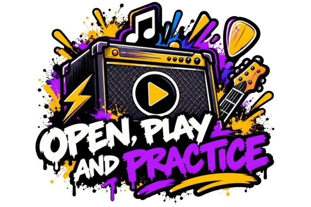
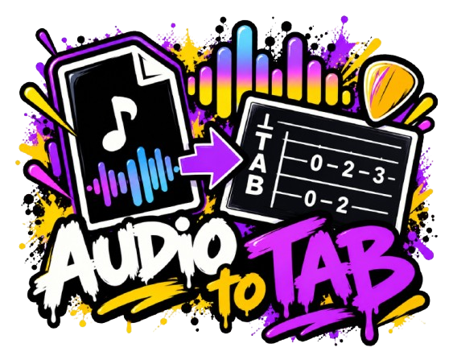
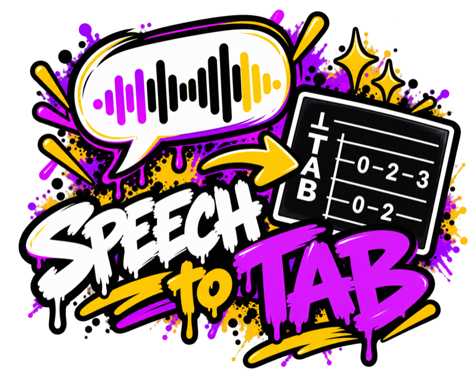

<p align="center">
  
</p>

# Smart Beat

A modern, cross-platform tablature editor in the spirit of Guitar Pro 5, with optional **self-hosted AI** that turns a hummed melody into drums, bass, piano and guitar parts. Runs on macOS (Apple Silicon and Intel), Windows and Linux.

> **Status:** early preview. Smart Beat opens, plays and edits Guitar Pro files (GP3–GP8), MuseScore, MusicXML and MIDI, with a mixer, practice tools and a fretboard, and saves to its native format (Guitar Pro 7 `.gp`), to Guitar Pro 5, 4 and 3 and to MuseScore. It exports MusicXML (also compressed), MIDI, alphaTex, ASCII tab, WAV and, on macOS, M4A. [`docs/file-formats.md`](docs/file-formats.md) lists what each format cannot hold. The AI features are next. The roadmap lives in the [project board](https://github.com/users/mbalyi/projects/3) and in [`high-level-plan.md`](high-level-plan.md).

## Download

<p>
  <a href="https://github.com/mbalyi/smart-beat/releases/latest"></a>
  <a href="https://github.com/mbalyi/smart-beat/releases/latest"></a>
  <a href="https://github.com/mbalyi/smart-beat/releases/latest"></a>
</p>

The buttons open the [latest release](https://github.com/mbalyi/smart-beat/releases/latest), where every installer is attached.

## Features

<table>
  <tr>
    <td valign="top" width="25%">
      
      <p><b>🟢 Available</b></p>
      <p>View GP3–GP8 songs as tab and standard notation, play them with a cursor, a mixer and a fretboard, and practice with loops, the Speed Trainer, a metronome and count-in.</p>
    </td>
    <td valign="top" width="25%">
      
      <p><b>🟢 Available</b></p>
      <p>Write notes on tab or staff with full undo and redo, for guitars, basses, drums and any MIDI instrument, and save to Guitar Pro, MusicXML, MIDI and more.</p>
    </td>
    <td valign="top" width="25%">
      
      <p><b>🟢 Available</b></p>
      <p>Learn and improve with:</p>
<ul><li>Speed Trainer</li><li>Loops</li><li>Metronome</li><li>Fretboard view</li><li>Follow mode</li></ul>
    </td>
  </tr>
  <tr>
    <td valign="top" width="25%">
      
      <p><b>🟢 Available</b></p>
      <p>Upload an audio file and let AI generate MIDI and tab for you.</p>
    </td>
    <td valign="top" width="33%">
      
      <p><b>🟣 AI · Coming soon</b></p>
      <p>Record yourself playing and let AI generate MIDI and tab from your performance.</p>
    </td>
    <td valign="top" width="33%">
      
      <p><b>🟣 AI · Coming soon</b></p>
      <p>Tell the app what you want and let AI generate a few matching tab ideas.</p>
    </td>
  <tr>
    <td valign="top" width="33%">
      
      <p><b>🟣 AI · Coming soon</b></p>
      <p>Hum a melody and get chords plus drum, bass, piano and guitar parts, generated by AI on your own machine.</p>
    </td>
  </tr>
</table>

### More about the features

- **Open Guitar Pro files** (`.gp3`, `.gp4`, `.gp5`, `.gpx`, `.gp`) with File › Open… (⌘O / Ctrl+O) or by dropping them on the window. Damaged or unsupported files get a clear message.
- **Read the music** as standard notation, tablature, or both, per track, optionally with rhythm under the tab. Choose the track, and a page or a continuous (horizontal) layout.
- **Play it**: play, pause, stop (Space plays and pauses), start from any bar by clicking it or typing its number. The cursor follows the music and the score scrolls with it. Tempo changes in the song are respected.
- **Mix it**: master volume, and volume, pan, mute and solo per track. The mix starts from the file's own settings and is saved per song (by its content, so renaming or moving the file keeps it). Volume, mute and solo apply instantly. Pan applies at the next pause, because changing it mid-song would cut off ringing notes.
- **Two sound sets**: _Standard_ (Sonivox, 1 MB, the default) or _High quality_ (FluidR3 Mono, 15 MB), switchable in the mixer. Switching during playback keeps the current sounds playing while the new ones download, then continues from the same point after a short pause while they load.
- **Practice**: loop a range of bars (type them, or drag across bars in the score), play at 25–200 % speed, and let the **Speed Trainer** loop the bars from a slow speed up to a target, a step after each loop (or every few loops). Metronome and count-in, remembered between songs. All in the Playback menu too (Loop ⌘L, Metronome ⇧⌘M).
- **Fretboard, keyboard and drum pads** (View › Fretboard and Keyboard, ⇧⌘F): the notes being played on the track's instrument, following its tuning and capo. In edit mode, click a fret, key or pad to write that note.
- **Write music** (Edit › Edit Mode, ⌘E; File › New, ⌘N): an edit cursor on tab and staff. Type frets (two quick digits for 10–29) and pitches by letter (A–G), set note values, dots, rests, ties and tuplets (nested ones too), odd time signatures such as 7/8 and 11/16, write a second voice, select beats (Shift+arrows, drag, ⌘A) to copy, cut and paste them, with unlimited undo and redo (the Edit menu names what it will undo). Moving past the end of a bar or of the song adds beats and bars. The full key list is in Help › Keyboard Shortcuts.
- **Tracks and instruments** (the Tracks panel and the Track menu): add, remove, reorder and duplicate tracks. Guitars with 3–10 strings (7, 8 and 9-string presets for djent and deathcore), basses with 4–6, banjo, ukulele, drums and any General MIDI instrument, with tuning presets (drop D, C, B, A, A#, F# standard, drop E…), custom tunings (string by string) and a capo. A note appears when the lowest string is far below what the sound was recorded at. See [docs/extended-range-guitars.md](docs/extended-range-guitars.md). Drum tracks use the standard Guitar Pro drum-kit notation, shown in the track settings.
- **Stays up to date** (desktop app): a quiet check for a new version at most once a day, and Help › Check for Updates… on request. A new version shows its release notes and downloads only after you click **Download & Install**.

## Made possible by open source

A heartfelt thank you to the maintainers whose work makes Smart Beat possible. Meet a few of the projects behind the music (hover over a name to see what it does for Smart Beat).

<p align="center">
  <a href="https://alphatab.net/" title="Reads Guitar Pro files, draws the standard notation and the tablature, and drives the score, the cursor and parts of playback."></a>
</p>

<p align="center">
  <a href="https://github.com/sinshu/rustysynth" title="Turns notes and SoundFonts into sound: the software synthesizer of the audio engine."></a>
  <a href="https://github.com/RustAudio/cpal" title="Sends the sound to your speakers or headphones on macOS, Windows and Linux."> </a>
  <a href="https://github.com/pdeljanov/Symphonia" title="Decodes audio files (MP3, WAV, FLAC, Ogg, AIFF) for the audio track."></a>
  <a href="https://crates.io/crates/nam-rs" title="Plays Neural Amp Modeler captures, which model real guitar amplifiers."></a>
</p>

Special thanks to **[alphaTab](https://alphatab.net/)** ([source](https://github.com/CoderLine/alphaTab), MPL-2.0), the heart of Smart Beat: this project would not exist without it. If you like what Smart Beat does with scores, please give alphaTab a star, try it in your own project, and thank its maintainer, [Danielku15](https://github.com/Danielku15), and the contributors. alphaTab's logo and the RustAudio logo are shown with the maintainers' permission. Smart Beat is independent and is not affiliated with or endorsed by alphaTab or any of these projects. All notices are in Help › Open-Source Licenses.

## Installing

Download the installer for your system from the [latest release](https://github.com/mbalyi/smart-beat/releases/latest).

- **macOS:** the DMG is **signed with a Developer ID and notarized by Apple**, so it opens without a warning. Open the DMG and drag Smart Beat to Applications.
- **Windows and Linux: the installers are not signed.** You can still install them, but Windows will warn you first. Signing a Windows installer needs a code-signing certificate or a signing service from Microsoft, which is a paid subscription (about 10 USD a month, plus an identity check), and Smart Beat is a free project without a foundation or funding behind it yet. The plan to sign them later is in [`docs/code-signing.md`](docs/code-signing.md).

**Windows (`.exe` or `.msi`) without a signature:** Windows SmartScreen shows "Windows protected your PC". Click **More info**, then **Run anyway**, and the installer starts as usual.

**Linux without a signature:** Linux shows no warning.

- AppImage: make it executable and run it: `chmod +x ./*.AppImage && ./*.AppImage` (in the folder where you saved it)
- Debian and Ubuntu (`.deb`): `sudo apt install ./<downloaded file>.deb`
- Fedora and similar (`.rpm`): `sudo dnf install ./<downloaded file>.rpm`

Only install files you downloaded from the releases page of this repository. Once installed, the app updates itself (Help › Check for Updates…).

## Tech stack

| Layer                     | Technology                                                                                                                                        |
| ------------------------- | ------------------------------------------------------------------------------------------------------------------------------------------------- |
| Desktop shell ("backend") | [Tauri 2](https://v2.tauri.app) in Rust ([`src-tauri/`](src-tauri)): native window, menu bar, IPC commands                                        |
| UI                        | React 19 + TypeScript, [Vite](https://vite.dev), [Tailwind CSS 4](https://tailwindcss.com), [shadcn/ui](https://ui.shadcn.com) (Radix primitives) |
| Score and playback        | [alphaTab](https://alphatab.net) (MPL-2.0): Guitar Pro import, notation rendering, SoundFont synthesizer (alphaSynth) in a worker                 |
| Tests                     | Vitest + Testing Library + axe-core (UI), Playwright + axe (browser integration), `cargo test` with `tauri::test` (Rust)                          |
| Quality                   | ESLint (typescript-eslint, React Hooks, jsx-a11y), Prettier, rustfmt, clippy, cargo-deny                                                          |

## Prerequisites

Install these once per machine.

|                 | macOS                                                                                       | Windows                                                                                                                                                               | Linux (Debian/Ubuntu)                                                                                                                                                |
| --------------- | ------------------------------------------------------------------------------------------- | --------------------------------------------------------------------------------------------------------------------------------------------------------------------- | -------------------------------------------------------------------------------------------------------------------------------------------------------------------- |
| Node.js 24      | `nvm install` (uses [`.nvmrc`](.nvmrc))                                                     | [nodejs.org](https://nodejs.org) or `nvm-windows`                                                                                                                     | `nvm install`                                                                                                                                                        |
| pnpm            | `corepack enable`                                                                           | `corepack enable`                                                                                                                                                     | `corepack enable`                                                                                                                                                    |
| Rust (stable)   | [rustup](https://rustup.rs)                                                                 | [rustup](https://rustup.rs) (MSVC toolchain)                                                                                                                          | [rustup](https://rustup.rs)                                                                                                                                          |
| System          | Xcode or Xcode Command Line Tools (`xcode-select --install`)                                | [Microsoft C++ Build Tools](https://visualstudio.microsoft.com/visual-cpp-build-tools/) ("Desktop development with C++") and WebView2 (preinstalled on Windows 10/11) | `sudo apt install libwebkit2gtk-4.1-dev build-essential curl wget file libxdo-dev libssl-dev libayatana-appindicator3-dev librsvg2-dev libasound2-dev libdbus-1-dev` |
| License tooling | `cargo install cargo-about --locked --features cli` and `cargo install cargo-deny --locked` | same                                                                                                                                                                  | same                                                                                                                                                                 |

Optional: to build the universal (Apple Silicon + Intel) macOS app, run `rustup target add x86_64-apple-darwin aarch64-apple-darwin`.

Check your setup with `pnpm tauri info`.

## Getting started

```bash
corepack enable
pnpm install
pnpm tauri dev      # desktop app with hot reload
```

`pnpm dev` runs only the UI in a browser at http://localhost:1420. Native features (menu, About details) show a friendly "desktop app only" message there. Files open through the browser's file picker or drag and drop, and the mix is not saved.

`pnpm tauri dev` and `pnpm tauri build` first download the optional FluidR3 SoundFont (15 MB, checksum-verified, cached in `node_modules/.cache`). The Sonivox SoundFont and the music font are copied from alphaTab by its Vite plugin. Both end up in `public/` and are not committed.

## Scripts

| Command                                                | What it does                                                                                                                                          |
| ------------------------------------------------------ | ----------------------------------------------------------------------------------------------------------------------------------------------------- |
| `pnpm tauri dev`                                       | Run the desktop app in development mode                                                                                                               |
| `pnpm tauri build`                                     | Build installers for the current OS (see [Packaging](#packaging))                                                                                     |
| `pnpm lint` / `pnpm format` / `pnpm format:check`      | ESLint / Prettier                                                                                                                                     |
| `pnpm typecheck`                                       | TypeScript project check                                                                                                                              |
| `pnpm test` / `pnpm test:watch` / `pnpm test:coverage` | Vitest unit and integration tests (UI)                                                                                                                |
| `pnpm test:e2e`                                        | Playwright browser integration tests (Chromium and WebKit, a11y and responsive checks). Run `pnpm exec playwright install chromium webkit` once first |
| `pnpm rust:test` / `pnpm rust:lint` / `pnpm rust:fmt`  | Rust tests, clippy (`-D warnings`), rustfmt check                                                                                                     |
| `pnpm licenses:check`                                  | Enforce the license policy for npm packages and Rust crates                                                                                           |
| `pnpm licenses:generate`                               | Regenerate `public/third-party-licenses.txt` (runs automatically before `tauri build`)                                                                |
| `pnpm soundfonts:fetch`                                | Download the FluidR3 SoundFont into `public/soundfont/` (runs automatically before `tauri dev` and `tauri build`)                                     |
| `pnpm check`                                           | Everything CI runs, except Playwright and the license gate                                                                                            |

## Testing

| Layer               | Where                                                                                                                               | Tool                                                                                                                                                                                                                              |
| ------------------- | ----------------------------------------------------------------------------------------------------------------------------------- | --------------------------------------------------------------------------------------------------------------------------------------------------------------------------------------------------------------------------------- |
| UI unit             | `src/**/*.test.ts(x)` next to the code                                                                                              | Vitest, Testing Library, axe-core                                                                                                                                                                                                 |
| UI integration      | [`src/App.test.tsx`](src/App.test.tsx), [`score-workspace-editing.test.tsx`](src/components/score/score-workspace-editing.test.tsx) | Vitest with `@tauri-apps/api/mocks`: the whole UI plus a mocked Rust IPC (commands, menu events and menu state), editing a real score                                                                                             |
| Browser integration | [`e2e/`](e2e)                                                                                                                       | Playwright in Chromium (≈ WebView2 on Windows) and WebKit (≈ WKWebView on macOS, WebKitGTK on Linux): WCAG 2.2 AA scans in light and dark mode, keyboard navigation, focus management, reduced motion, layouts at 375/768/1280 px |
| Rust unit           | `#[cfg(test)]` modules in [`src-tauri/src`](src-tauri/src)                                                                          | `cargo test`                                                                                                                                                                                                                      |
| Rust integration    | [`src-tauri/tests/ipc.rs`](src-tauri/tests/ipc.rs)                                                                                  | `tauri::test` mock runtime: real command wiring over IPC and menu routing                                                                                                                                                         |

The frontend fixtures in [`src/test/tauri.ts`](src/test/tauri.ts) mirror the JSON returned by the Rust commands. The Rust integration tests assert the same shape.

alphaTab needs a real browser to render and play, so Vitest tests use a fake player ([`src/test/fake-score-player.ts`](src/test/fake-score-player.ts)) while parsing and editing run for real on alphaTab's model. The Playwright tests in [`e2e/`](e2e) (`score`, `practice`, `editing`, `instrument-view` and `tracks` specs) drive the real renderer and synthesizer. Their songs in [`e2e/fixtures/`](e2e/fixtures) are original and generated by [`scripts/make-fixtures.mjs`](scripts/make-fixtures.mjs). Don't commit commercial transcriptions.

## Packaging

```bash
pnpm tauri build                                   # installers for the current OS
pnpm tauri build --target universal-apple-darwin   # macOS: one app for Apple Silicon + Intel
```

Output lands in `src-tauri/target/<target>/release/bundle/`:

| OS      | Artifacts                                                     |
| ------- | ------------------------------------------------------------- |
| macOS   | `macos/Smart Beat.app`, `dmg/Smart Beat_<version>_<arch>.dmg` |
| Windows | `msi/*.msi`, `nsis/*-setup.exe`                               |
| Linux   | `appimage/*.AppImage`, `deb/*.deb`, `rpm/*.rpm`               |

Local macOS builds are ad-hoc signed. See [`docs/code-signing.md`](docs/code-signing.md) for signing and notarization.

## Project layout

```
src/                 React UI
  components/        App components (+ ui/ generated by shadcn)
    score/           Song screen: toolbars, score view, instrument panel, transport and
                     practice tools, mixer, tracks panel and dialogs
  hooks/ providers/  Theme, menu (actions and state), editor keys, file-open/drop hooks
  lib/tauri.ts       Typed bridge to the Rust commands and events
  lib/score/         alphaTab adapter (player.ts), parsing, mixer and practice models,
                     editor (editor.ts, history.ts, snapshot.ts, model.ts), tracks,
                     instrument view data, music vocabulary (music.ts), SoundFonts
  test/              Test setup, IPC mocks, fake player, axe helper
src-tauri/           Rust core
  src/menu.rs        Native menu bar and shortcut formatting
  src/menu_state.rs  Menu labels, check marks and enabled items, sent by the UI
  src/commands.rs    IPC commands (thin wrappers)
  src/score_file.rs  Reading Guitar Pro files (signature and size checks)
  src/mixer.rs       Per-song mixer settings in the app data folder
  src/zoom.rs        View → Zoom levels
  tests/ipc.rs       Integration tests on the Tauri mock runtime
e2e/                 Playwright tests (+ fixtures/ test songs)
scripts/             License check, notice generation, SoundFont download, test songs
docs/                Licensing, code signing, releases and updates, ADRs
.github/workflows/   CI (every PR) and Release (installers)
```

### How the UI talks to Rust

- **Commands** (`invoke`), defined in `src-tauri/src/commands.rs` and wrapped with types in `src/lib/tauri.ts`:
  - `app_info` and `menu_shortcuts` (About and Keyboard Shortcuts dialogs);
  - `read_score_file(path)` returns a Guitar Pro file as raw bytes. It only reads files with a Guitar Pro extension and signature, up to 100 MB, and fails with `{ kind, message }`;
  - `load_mixer_settings(fileKey)` / `save_mixer_settings(fileKey, settings)` store a song's mix as `<app data>/mixer/<sha256>.json`;
  - `update_menu_state(state)` keeps the menu bar in step with the UI: "Undo Add note", check marks for Edit Mode, Fretboard, Loop, Metronome and Count-In, and song-only items disabled while no song is open.
- **Plugins:** the dialog plugin shows the native Open dialog (`dialog:allow-open`).
- **Events:** clicking a native menu item goes to `menu::handle_event`. Window actions (zoom, full screen, close, quit) are handled in Rust. Everything else is emitted as a `menu-action` event, which the UI handles in `useMenuActions` (the app handles New, Open and dialogs; the song workspace handles Undo/Redo, edit mode, tracks and practice). Undo and Redo are custom items so they undo score edits; in a text field they fall back to the field's own undo. Cut, Copy, Paste and Select All stay the platform's own items, and the score editor handles those keys itself. Files dropped on the window arrive as Tauri drag-and-drop events with their paths (`useFileDrop`).

## CI/CD

- **[CI](.github/workflows/ci.yml)** runs on every PR and every push to `main`:
  - lint, format, types and Vitest with coverage;
  - Playwright, one job per browser (Chromium and WebKit);
  - Rust fmt, clippy and tests, plus an app compile on **macOS, Windows and Linux**;
  - the license policy (npm and cargo-deny, including advisories).
- **[Analytics Worker](.github/workflows/analytics-deploy.yml)** tests the usage-counter backend in [`analytics/`](analytics) and deploys it to Cloudflare from `main` ([`docs/analytics.md`](docs/analytics.md)).
- **[Release](.github/workflows/release.yml)** builds `.dmg` (universal), `.msi` and `.exe`, and `.AppImage`, `.deb` and `.rpm` installers. Push a tag matching `package.json` (e.g. `git tag v0.1.0 && git push origin v0.1.0`) to create a draft GitHub Release, or run it manually to get the installers as workflow artifacts. PRs that change packaging configuration (`tauri.conf.json`, icons, EULA, the workflow itself) also build the installers as artifacts. A release also contains signed updater bundles and `latest.json`, which the app's **Help › Check for Updates…** and its daily automatic check read: see [`docs/release.md`](docs/release.md) for how to cut a release, the signing key and the stable download links.

## Privacy and usage statistics

Smart Beat counts anonymously how often features are used (Loop, Metronome, Export and so on), per day, together with the app version, your operating system and the installer type. There is **no identifier** of any kind, so the counts cannot be tied to you or your computer, and nothing about your songs, file names or sounds is sent. Counts are kept on your computer while you are offline and sent in one batch later. Turn it off in **Help › Settings…**; that also deletes counts that have not been sent. Development and pull-request builds never send anything. Details, the exact list of counted features and the backend: [`docs/analytics.md`](docs/analytics.md).

## Licensing

Smart Beat is **source-available, not open source**. The code is under the [PolyForm Noncommercial License 1.0.0](LICENSE): you may use it for personal use, learning and research. Selling it, wrapping it in another product, offering it as a service, or using it inside a company needs permission or a fee: see [`COMMERCIAL-LICENSE.md`](COMMERCIAL-LICENSE.md). The released installers are free to download under the draft [`EULA.md`](EULA.md).

We only use dependencies whose licenses allow commercial, closed-source distribution, and CI enforces this.

- [`docs/licensing.md`](docs/licensing.md): the component review, obligations, and the list of projects we must not copy code from.
- [ADR 0002](docs/adr/0002-source-available-noncommercial-license.md): why we chose this license (it replaces [ADR 0001](docs/adr/0001-project-license.md)).

## Contributing

Pull requests, bug reports and ideas are welcome: see [`CONTRIBUTING.md`](CONTRIBUTING.md) for what contributing does and does not give you.
