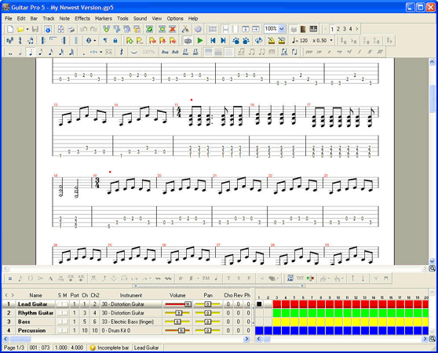
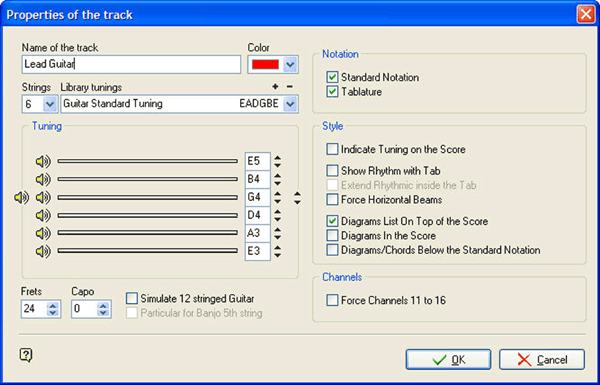
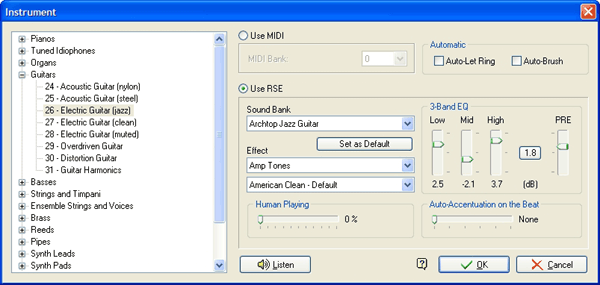
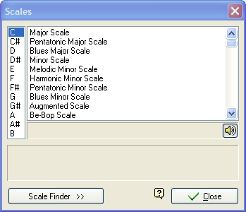
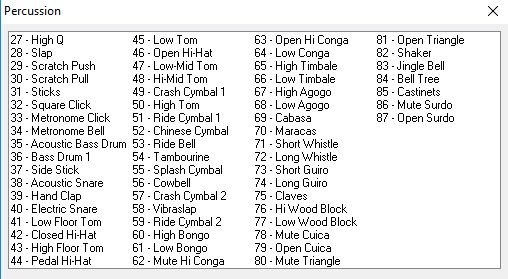

# Guitar Pro 5 reference

What Guitar Pro 5 (GP5) looked like and what it could do. Smart Beat started as a modern rewrite of GP5 (see `high-level-plan.md`), so this is the baseline for "feature parity". For the newer generation see [guitar-pro-8-features.md](guitar-pro-8-features.md). For how each GP5 feature maps onto Smart Beat see [guitar-pro-5-mapping.md](guitar-pro-5-mapping.md).

Screenshots live in [`docs/assets/gp5`](assets/gp5) and are reference material only (see [assets/README.md](assets/README.md)).

## Facts

| | |
|---|---|
| Vendor | Arobas Music (France) |
| Released | November 2005 (Windows), July 2006 (Mac OS X, PowerPC and Intel) |
| Last versions | 5.1, then 5.2 (Windows, Vista support) |
| File format | `.gp5` (binary, no forward compatibility; GP4 = `.gp4`, GP3 = `.gp3`) |
| Headline feature | Realistic Sound Engine (RSE): playback from recorded instrument samples instead of plain General MIDI |
| Sound quality | RSE shipped with 14 sound banks (2 nylon, 2 acoustic, 2 electric, 1 jazz guitar, 4 bass, 3 drum kits), 44.1 kHz / 16 bit |
| Successors | GP6 (`.gpx`, 2010), GP7 (`.gp`, 2017), GP8 (2022) |

Sources: [Wikipedia: Guitar Pro](https://en.wikipedia.org/wiki/Guitar_Pro), [PCMag UK review gallery](https://uk.pcmag.com/software/80897/guitar-pro-5?p=3), [Ultimate Guitar thread on reading drum tab](https://www.ultimate-guitar.com/forum/showthread.php?t=1710671), [Audiofanzine](https://en.audiofanzine.com/tablature-editor/arobas-music/Guitar-Pro-5/), [Amazon listing text for 5.1](https://www.amazon.com/Guitar-Pro-5-1-Old-Version/dp/B000GAMYSK).

## Interface tour

### Main window

Top to bottom:

1. **Title bar**: "Guitar Pro 5 - `<file>.gp5`".
2. **Menu bar**: File, Edit, Bar, Track, Note, Effects, Markers, Tools, Sound, View, Options, Help.
3. **Toolbars** (several stacked rows of small icon buttons):
   - file/edit/print row, transport (play, previous/next bar), tempo (`♩ = 120`), speed multiplier (`x 0.50`), voice selector `1 2 3 4`;
   - note entry row: durations (whole to 64th), dot, triplet, tie, rest, accidentals;
   - a second, collapsible row of note effects (hammer-on, slide, bend, vibrato, palm mute, let ring, harmonics, ...), shown again as a strip just above the track pane.
4. **Score area** (centre): standard notation stacked on top of tablature per track, bar numbers in red above each system, current bar highlighted with a red marker. Page layout view (white paper on grey).
5. **Track pane** (bottom): one row per track with columns `S` (solo), `M` (mute), `Port`, `Ch`, `Ch2` (MIDI port and channels), `Name`, `Instrument`, `Volume`, `Pan`, `Cho` (chorus), `Rev` (reverb), `Ph` (phaser), and a coloured **bar grid** (one cell per bar, one colour per track, black square = cursor). This grid is also the quick navigator.
6. **Status bar**: page `1/3`, bar `001 : 073` (bar : beat), time signature fill (`1.000 : 4.000`), "Incomplete bar" warning, current track name.

Design notes worth keeping: dense, keyboard-driven, everything on one screen, per-track mixer strip that doubles as a song overview.

### Track properties dialog

- Name, colour.
- Strings (4-7 for tab; 6 shown), **library of tunings** (`EADGBE`, add/remove).
- Per-string tuning fields with an audition speaker per string.
- Frets (24) and Capo, "Simulate 12 stringed guitar", banjo 5th string.
- Notation: standard notation and/or tablature checkboxes.
- Style: show tuning on the score, rhythm with tab, force horizontal beams, chord diagram placement (top of score, in score, below staff).
- Force MIDI channels 11 to 16.

### Instrument dialog (sound selection)

- Tree of General MIDI families (Pianos, Guitars, Basses, Strings, Brass, Reeds, Pipes, Synth ...) with 100+ instruments.
- **Use MIDI** (with bank) or **Use RSE**.
- RSE: sound bank (for example "Archtop Jazz Guitar"), **effect** presets (amp tones such as "American Clean"), a **3-band EQ** (Low, Mid, High) plus **PRE** gain, **Human Playing** slider, **Auto-Accentuation on the Beat**, and **Auto-Let Ring** / **Auto-Brush** toggles.
- "Listen" button to audition.

### Scale selection

Hundreds of scales; pick a root and scale, see and hear it, and highlight it on the virtual fretboard.

### Drum / percussion dialog

"Percussion" picker shown when entering notes on a drum track: a plain list of General MIDI percussion notes **27-87**. Each entry is `MIDI number - name`, for example `35 - Acoustic Bass Drum`, `38 - Acoustic Snare`, `42 - Closed Hi-Hat`, `44 - Pedal Hi-Hat`, `46 - Open Hi-Hat`, `49 - Crash Cymbal 1`, `51 - Ride Cymbal 1`, `53 - Ride Bell`, `57 - Crash Cymbal 2`, `59 - Ride Cymbal 2`, plus toms 41/43/45/47/48/50, percussion 54-87 (tambourine, cowbell, bongos, congas, timbales, agogo, cabasa, maracas, whistles, guiro, claves, wood blocks, cuica, triangle, shaker, jingle bell, bell tree, castanets, surdo).

Users enter drums either on a 5-line drum staff or in tab using the MIDI number as the "fret". This is the weak spot GP8 later redesigned (see the element picker and drum mixer in the GP8 doc).

## Feature summary

Verified items come from the sources above. Items marked (plan) are from `high-level-plan.md` section 2, which itself is marked "to verify".

### Notation and editing
- Multi-track score with standard notation, tablature and rhythm slashes; two voices per track (GP5 added multi-selection and a second voice per track over GP4). Up to **7 strings** for tab (4-7), plus keyboards, drums, vocals.
- Key and time signatures, tempo, triplet feel, n-tuplets, ties, grace notes, dynamics, fingering.
- Repeats, alternate endings, Coda / Segno / D.C. / D.S., section markers, free text, lyrics (up to 5 lines, followed during playback) (plan).
- Chord diagrams, chord recognition and a chord wizard (plan).
- Copy/paste of bars and beats, bar-duration check, transpose, automatic conversion between tab and standard notation (plan).

### Guitar techniques
Bends with an editable curve, slides (legato, shift, in, out), hammer-on/pull-off, vibrato, trills, tremolo picking, palm mute, let ring, dead and ghost notes, staccato, accents, natural/artificial/tapped/pinch/semi harmonics, tapping, slap, pop, whammy bar (dive, dip), rasgueado, pick direction, arpeggio and brush, fade-in, wah open/closed (plan). GP5 added wah-wah, accentuated notes, better artificial harmonics, bend and tremolo improvements.

### Playback and sound
- **RSE** with sampled guitars, basses and drums, amp and effect chain per track, EQ, human-playing randomisation, auto-accentuation, auto let-ring and brush.
- Or plain MIDI output (ports and channels per track).
- Per-track volume, pan, chorus, reverb, phaser; automation of volume, pan, tempo and effects along the timeline (plan).
- Metronome, count-in, loop, **Speed Trainer** (gradual tempo ramp), speed multiplier.

### Tools
Virtual fretboard and piano keyboard, scale tool, chord tools, microphone tuner, MIDI step-input from a keyboard, page / screen / "parchment" views, style sheets (plan).

### Files
- Native: `.gp5`; opens `.gp3`, `.gp4`, `.gtp`.
- Import/export: MIDI, ASCII tab, MusicXML, Power Tab; export WAV and print (plan). See the format research in [tab-formats-and-sound-research.md](tab-formats-and-sound-research.md).

## Known limitations of GP5 (what to do better)

- Drum entry via MIDI numbers and one mixed "drum" mixer channel: no per-element volume/pan (GP8 fixed this).
- No audio track, no user-visible effect chain editor (chain was picked from presets).
- 32-bit Windows app, Mac build is a 32-bit Carbon app that no longer runs on modern macOS.
- About 9-10 simultaneous instruments before playback problems (user reports).
- Closed proprietary format with only reverse-engineered documentation.
