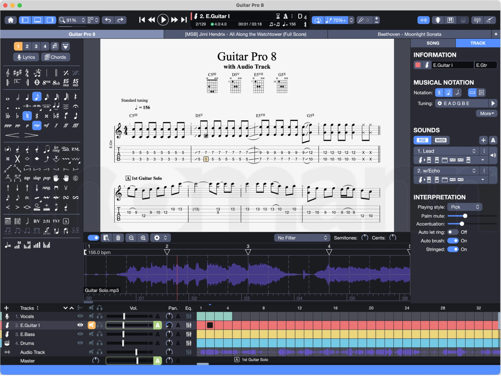
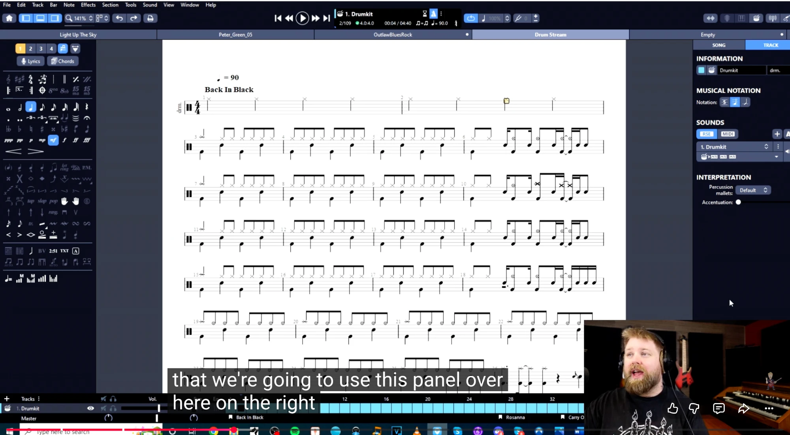
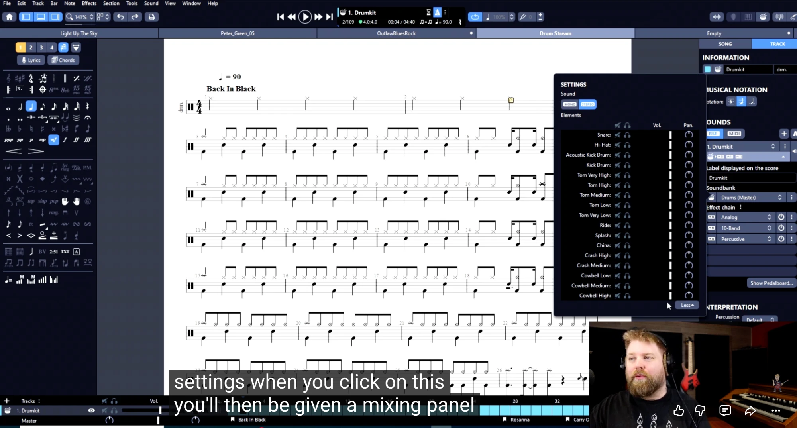
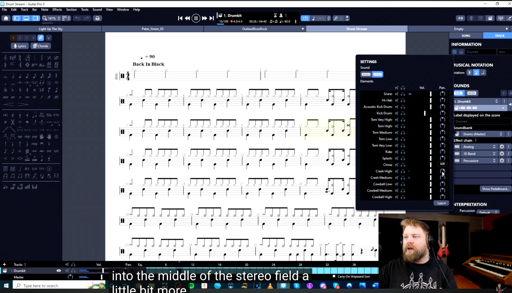
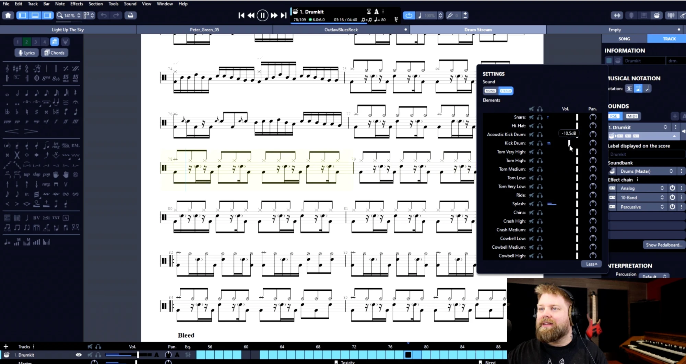
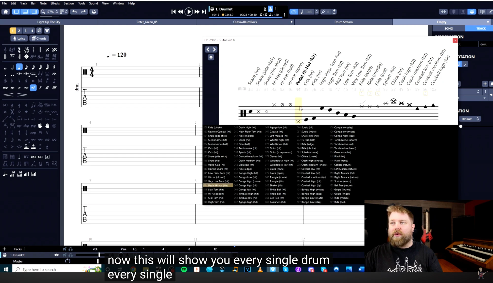
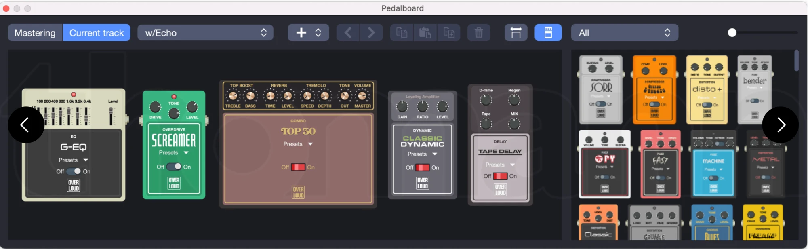
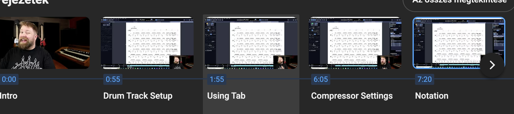

# Guitar Pro 8 features

Capabilities and UI of Guitar Pro 8 (GP8, May 2022, Arobas Music), collected from the official site, reviews and screenshots taken from a GP8 tutorial video and the app itself. Smart Beat's target UI is GP8-like, see [guitar-pro-5-reference.md](guitar-pro-5-reference.md) for the older baseline and [guitar-pro-5-mapping.md](guitar-pro-5-mapping.md) for what Smart Beat has today.

Screenshots: [`docs/assets/gp8`](assets/gp8) (reference only, see [assets/README.md](assets/README.md)).

Sources: [Guitar Pro features](https://www.guitar-pro.com/c/14-guitar-pro-features), [GP8 new features](https://www.guitar-pro.com/c/10-guitar-pro-new-features), [Track sound docs](https://www.guitar-pro.com/docs/gp8/audio/soundsetup/sound-settings), [Audio track docs](https://www.guitar-pro.com/docs/gp8/audio/backing-track), [GP8 user guide (PDF)](https://static.guitar-pro.com/gp8/manual/Guitar-Pro-8-user-guide.pdf), [Rekkerd](https://rekkerd.org/guitar-pro-8-brings-audio-tracks-nested-tuplets-pedalboard-more/), [GearNews](https://www.gearnews.com/guitar-pro-8-do-you-need-it-and-is-it-worth-it/), [Guitar World](https://www.guitarworld.com/news/guitar-pro-8).

## Facts

| | |
|---|---|
| Platforms | Windows 8/10/11, macOS 10.13+ (native Apple Silicon since 8.0.x) |
| Price | about 70 EUR, 7-day full trial, 5 machines per licence |
| Native format | `.gp` (zip archive with XML, same family as GP7) |
| Engine | RSE (Realistic Sound Engine): over 1000 preset sounds, about 200 sound banks, about 80 effect and amp models, 100+ instruments; or plain MIDI, mixable per track |
| Languages | English, French, German, Korean, Spanish, Italian, Japanese, Polish, Portuguese, Russian, Swedish, Traditional and Simplified Chinese |

## Interface tour

### Main window

Regions, top to bottom and left to right:

1. **Toolbar**
   - Left: home, three **view mode** buttons (page, screen/continuous, ...), zoom (`91%`), layout options, undo / redo.
   - Centre: transport (first bar, rewind, play/pause, fast-forward, last bar) and a dark **LCD display**: current track and instrument name, bar `2/129`, coloured status dot and time signature `4:0.4:0`, elapsed / total time `00:01 / 03:18`, tempo `♩=♫ ♩=156`, metronome and count-in toggles, key/pitch readout.
   - Right of transport: **loop** toggle, **speed** control (`70%+`), tuner/line-in, count-in, and to the far right buttons for the audio track, focus mode, piano/fretboard views, drum view and design/inspector toggles.
2. **Document tabs** under the toolbar: several scores open at once (the screenshots show four tabs), each with an unsaved-changes dot.
3. **Left palette** (dark, icon grid): voice buttons `1 2 3 4`, Lyrics, Chords, then note durations, dots/tuplets, accidentals, dynamics, hairpins, clefs and octave marks, bar tools (repeats, sections), technique effects (bend, slide, hammer, palm mute, let ring, harmonics, tap, slap, pop, rasgueado, vibrato, whammy, ...), articulations, chord/text/beat tools, and at the bottom automation tools (tempo, volume, pan, sound changes).
4. **Score area** (centre): white page with title block, chord diagrams in the header, tuning label, tempo marking, rehearsal sections (`A 1st Guitar Solo`), standard notation + TAB, page shadow on a grey desk.
5. **Right inspector**, tabs **SONG** and **TRACK**. TRACK shows:
   - *Information*: colour swatch, instrument icon, name (`E.Guitar I`) and short name (`E.Gtr`).
   - *Musical notation*: notation toggles (tab, standard, rhythm, slash, ...), tuning (`E A D G B E`, gear button to edit), *More* menu.
   - *Sounds*: engine switch **RSE / MIDI**, add-sound `+` and auto `A`, one row per sound (`1. Lead`, `2. w/Echo`) with a sound-bank selector and a **mini effect chain** (icons of the pedals in the chain, a dropdown to expand it).
   - *Interpretation*: playing style (Pick), palm mute, accentuation (sliders), auto let ring, auto brush, stringed (toggles).
6. **Audio track panel** (optional, collapsible strip between score and tracks): waveform, per-bar sync markers (triangles), tempo readout (`156.0 bpm`), file name, toolbar with on/off, zoom, delete, settings, **filter** dropdown (`No Filter`), **Semitones** and **Cents** dials. See [Audio track](#audio-track).
7. **Track list / mixer** (bottom): header `Tracks`, then `Vol`, `Pan`, `Eq`; one row per track with visibility (eye), mute, solo, volume fader with **A** (automation) toggle, pan knob, EQ button, and the coloured **bar grid**; a separate **Audio Track** row with its own waveform, and a **Master** row with volume, pan and its own effect entry. Section markers are shown under the grid.

### Track inspector for a drum track

Same inspector, adapted: *Information* (colour, drum icon, name `Drumkit`, short name `drm.`), *Musical notation* (drum notation options), *Sounds* (RSE / MIDI, `1. Drumkit` sound with mini chain), *Interpretation* (percussion mallets: Default, accentuation slider).

### Drum mixer (per-element volume and pan)

A floating **Settings > Sound** panel opened from the drum sound row (a "Show drum mix" style button). It contains:

- **Mono / Stereo** switch.
- **Elements** table, one row per kit piece: Snare, Hi-Hat, Acoustic Kick Drum, Kick Drum, Tom Very High, Tom High, Tom Medium, Tom Low, Tom Very Low, Ride, Splash, China, Crash High, Crash Medium, Cowbell Low, Cowbell Medium, Cowbell High.
- For each element: **mute**, **solo/headphones**, a **volume** fader (tooltip shows dB, for example `-10.5 dB`), and a **pan** knob (tooltip shows the value, for example `30R`).
- A small **level meter** next to each element lights up while the score plays, and the currently playing bars are highlighted in the score.
- A **Less/More** toggle to collapse the panel.

This is what the tutorial chapter "Compressor Settings" builds on: the presenter pans hi-hat / toms / cymbals across the stereo field, pulls the kick down, and then adds a compressor to the drum track's effect chain.

### Drum element picker

"Drumkit" window (opened by the drum view button): a horizontal strip of **every drum articulation** written vertically over a mini drum staff, with the MIDI note number below each. Entries are named `Snare (hit)`, `Snare (side stick)`, `Snare (rim shot)`, `Hi-Hat (closed)`, `Hi-Hat (half)`, `Hi-Hat (open)`, `Pedal Hi-Hat (hit)`, `Kick (hit)`, `High Floor Tom`, `High Tom`, `Mid Tom`, `Low Tom`, `Very Low Tom`, `Ride (edge / middle / bell)`, `Splash`, `China`, `Crash high / medium`, `Cowbell low / medium / high`, and so on. Below is the full GM percussion table, grouped in columns with the selected entry highlighted (`044 Pedal Hi-Hat (hit)`). Clicking a note on the staff inserts that articulation. Compare with the flat MIDI-number list in GP5.

### Pedalboard

Separate **Pedalboard** window (macOS title bar in the screenshot):

- Top bar: **Mastering** vs **Current track** switch, chain preset dropdown (`w/Echo`), add (`+`) menu, previous/next preset arrows, copy / paste / duplicate / delete, layout toggles, effect category filter (`All`) and a zoom slider.
- Left area: the **signal chain**, drawn as real pedals and a combo amp left to right: graphic EQ (`G-EQ`), overdrive (`Screamer`), combo amplifier (`Top 30`), compressor (`Classic Dynamic`), tape delay (`Tape Delay`). Each pedal has photorealistic knobs, a preset dropdown, an **On / Off** switch and a small OVERLOUD logo (GP8's effects are licensed from Overloud). Arrows scroll long chains.
- Right area: the **library** of available pedals in a scrolling grid (compressors, distortions and fuzzes such as `disto+`, `bender`, `Fast`, `Machine`, `Metal`, `Classic`, `Grunge`, `Blues`, `Preamp`; plus EQs, modulation, delays, reverbs, amps). Drag from the library into the chain, drag a pedal out (or press Delete) to remove, drag to reorder.
- Limits: **up to 6 effects per track sound**, **up to 3 effects for global mastering**.

### Video chapter strip

Chapters of the tutorial the screenshots come from: Intro, Drum Track Setup, Using Tab, Compressor Settings, Notation. Useful as an outline of what a "set up a drum track" user story looks like: pick sound, open drum mixer, balance elements, add compressor, switch to tab/notation view.

## Feature catalogue

### Notation and editing
- Instruments: 3-10 string guitars with custom tunings, bass, ukulele, violin, winds, brass, keyboards / piano (fingering, sustain pedal), drums, percussion, vocals.
- Views: tablature, standard notation, rhythmic / slash notation, **Jianpu** (numbered notation), drum slash and standard.
- Techniques: bends (including quarter-tone whammy bar), vibrato, slides, hammer-ons, palm mute, let ring, harmonics, tapping, slap, pop, rasgueado, pick scrape and more, with **customisable text** for palm mute, slap, pop, rasgueado, pick scrape.
- **Nested tuplets**, decimal tempo values, cautionary accidentals, diatonic transposition, transposed chords with names and fingerings.
- **Command palette** (Expression Text / Action List): keyboard-first search for any notation action.
- Per-note **duration, offset and relative velocity** editing.
- Chords: chord diagram library (thousands of chords), chord recognition; **scale diagrams** for 3-10 strings up to 24 frets with custom dot shape, colour, text and orientation; scale database.
- Lyrics, copyright / author metadata, annotations, password-protected files.
- **Design mode**: bar alignment and beat placement with automatic guidelines, chord diagram spacing, custom music-symbol font, **stylesheets** (fonts, graphic look, save and reuse).
- Copy / paste, undo / redo, pinned recent files.

### Playback, practice
- Metronome with **visual countdown** on the LCD, count-in, loop, **speed trainer**, fixed-tempo mode, relative speed via `+`/`-` during playback, solo / mute per track, **Focus / Unfocus track** (boost or attenuate a track relative to the mix).
- Virtual fretboard, keyboard, drum kit view; left-hand position visualisation.
- **Line-in**: play along through the sound card, with the guitar sound locked across tracks and sessions.
- Soundbank **preview on hover** while the tab plays.

### Sound engine
- RSE with sampled guitars, basses, drums; MIDI mode; mix engines per track.
- **Sounds**: each sound = sound bank + effect chain; a track can have **several sounds** and switch between them with **sound automations**.
- **Pedalboard / virtual effect chain**: reverb, chorus, delay, compressor, EQ, tremolo, overdrive / distortion / fuzz, amps, dozens of licensed classic pedals; presets per pedal and per chain. See [Pedalboard](#pedalboard).
- **Mastering** chain with compressor / limiter, reverb and **10-band EQ**.
- **Mixing**: per-track volume, pan, EQ button, mute, solo, automation (`A`) for volume, pan and more; Master fader.
- **Drum mixing** per element (volume, pan, mute, solo, mono / stereo). See [Drum mixer](#drum-mixer-per-element-volume-and-pan).
- **Detune** (alternative tunings), relative tempo, fine per-note sound adjustments.

### Audio track
- Add `.mp3` or `.wav` (backing track, full song, teacher's recording) to a score.
- Waveform display with **sync points** (triangles): double-click on the waveform to add, drag to align the bar to the audio. Tempo automations can be **imported** as sync points.
- **Time-stretching** to change speed without pitch change, **Semitones** and **Cents** transposition, **filter** dropdown (for example to isolate bass while transcribing), zoom, delete, on/off toggle.
- Compatible with relative tempo and detune modes; audio track has its own mixer row (volume, pan, EQ).

### File formats
- Import: `.gtp`, `.gp3`, `.gp4`, `.gp5`, `.gpx`, `.gp`, Power Tab, MIDI, ASCII tab, TablEdit, MusicXML, audio (`.mp3`, `.wav`).
- Export: `.gp5`, `.gp`, `.gpx`, Power Tab, MIDI, ASCII, TablEdit, `.mp3`, `.wav`, FLAC, OGG, AIFF, PDF, PNG (transparent background), SVG.
- See [tab-formats-and-sound-research.md](tab-formats-and-sound-research.md) for what Smart Beat should support.

### mySongBook and ecosystem
Integrated store of professionally transcribed scores (rock, pop, metal, funk, reggae, blues, jazz, classical, country ...), full-band scores, simplified versions, scores with audio tracks, filters by genre, instrument / level and type; iOS / Android companion apps.

## Ideas to take, ideas to skip

Take: the dark three-column layout, LCD-style transport, inspector with sounds and a mini effect chain, drum mixer, pedalboard, audio track with sync points, per-track mixer with automation toggles, command palette, focus mode.

Skip or defer: mySongBook, the licensed Overloud effect models (Smart Beat needs its own effect DSP or open models), mobile apps, Jianpu.
